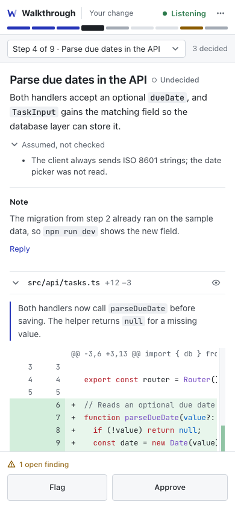
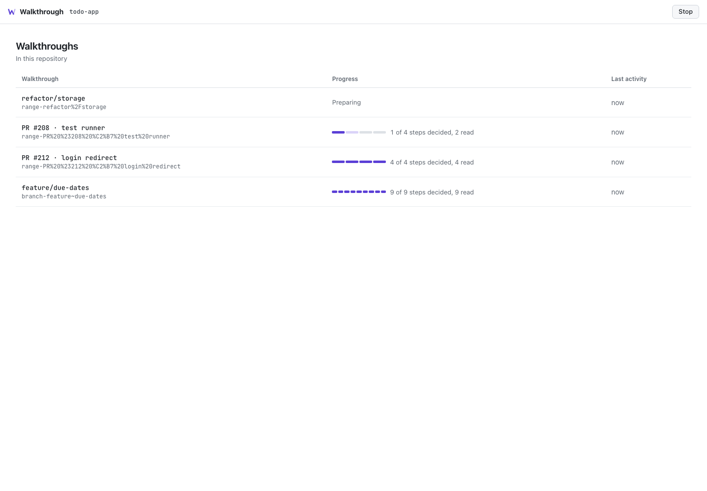

<p align="center"></p>

# Walkthrough

Walkthrough is a Claude Code plugin that gives you a pull request review page on your laptop, made better by AI.
It has the files, diffs, comments, threads and the one review at the end you know from your code host.
Your own Claude Code session adds the rest: it splits the change into steps in an order that makes sense, says what to look at in each, comments where it matters and answers your questions in the threads.
How it reviews comes from your own rules in `REVIEW.md` and from the project's instructions for agents.
Nothing about your language, team or code host is hardcoded in the tool.

I built it for two jobs: reviewing what my agent wrote before colleagues see it, and reviewing a colleague's pull request.
In both I want to notice every detail that matters, without the AI drifting off the ticket.

<picture>
  <source media="(prefers-color-scheme: dark)" srcset="docs/images/main-dark.png">
  
</picture>

## Install

You need Claude Code, git, and Node.js 22 or later.

```sh
claude plugin marketplace add evan-mcgeek/walkthrough
claude plugin install walkthrough@walkthrough
```

The plugin installs from the `release` branch, which holds the built plugin.

To run it from a clone instead:

```sh
git clone https://github.com/evan-mcgeek/walkthrough.git
cd walkthrough
npm install
npm run build
cd /path/to/the/repo/to/review
claude --plugin-dir /path/to/walkthrough/plugin
```

`--plugin-dir` loads the plugin for that session only, so start Claude Code from the repo you want to review and point it at the `plugin` folder of your clone.

## First run

In the repo with the change, run:

```text
/walkthrough
```

With no argument it walks through your current branch against the remote's default branch.
For another target branch or a range of commits, just say so in plain words, and the session passes the right options to the CLI.

To review a colleague's pull request, run `/walkthrough:pr` with its number or link:

```text
/walkthrough:pr 123
```

The session fetches the change as your policy says, without checking it out.
Right after it starts, it asks in the chat how well you know the feature, from "I know it well" to "It's new to me", and explains only as much as you need; you may skip the question.

The first time, the session finds no review policy and offers one.
Your policy lives at `~/.config/walkthrough/REVIEW.md` (or under `$XDG_CONFIG_HOME`), outside every project, and starts as a copy of [the template](plugin/skills/walkthrough/REVIEW.md).

1. Say "later" and the template's defaults apply to this walkthrough.
2. Say "now" and the session goes through the policy section by section, asks how you actually review that part, and edits your copy to match.

While your policy is still the unchanged template, the offer comes back on later runs.

The page opens straight away, and the steps appear as soon as the session records them.
Uncommitted edits are left out, with a warning, and nothing is ever checked out.

## How a walkthrough goes

1. **Steps.**
   The step list on the left holds the AI's steps in reading order, each with its files, and the Summary last.
   A step has a title, "Look at:" with one or two links to the lines that matter most, and a sentence or two of explanation, with More for the rest.
   Generated or copied files arrive folded, with one line saying why.
   While the AI is still reviewing, "AI reviewing" shows in the header and a spinner on the steps it has not finished.
2. **Files.**
   Each file has the header you know: path, +/-, comment count and Viewed.
   Viewed folds the file and counts toward "N / M files viewed"; when new commits change a file you viewed, it opens again as "Changed since last view".
3. **Comments.**
   Click a line number, or Shift-click a second one for a range, to comment.
   The AI's comments are pending review comments marked `[AI]`; edit or delete any of them, as you would your own.
   Colleagues' existing threads show on their lines, where you can reply and resolve.
   The AI never replies to your comments.
4. **Ask AI.**
   Ask AI in a thread or on picked lines, and the answer comes back as a reply in that thread.
   Questions and answers stay on the page and never go out with the review.
5. **Summary.**
   Finish review (G S) takes you to the Summary, your code host's "Finish your review" made visible: every comment that will go out, one line each with Edit and Delete; unresolved threads and files not yet viewed, as counts; the acceptance criteria as the AI checked them; then a summary, Comment, Approve or Request changes.
   On a pull request, Submit review has the session post it as one finished review with your summary, type and comments, and the page links to it.
   On your own change, Send to agent hands your comments to the session as a fix list for the agent that wrote the change.
   Nothing leaves before you submit.
6. **The change moves.**
   When new commits arrive, the same walkthrough goes on.
   Steps keep their files that still change, new files go into steps, and comments whose lines changed stay in the review.

Changed Markdown and image files get a Diff / Preview switch, with Before and After for images.

It works on a phone as well: at 390px the step list opens from the steps button in the header.



### Share it and find it again

Ask the session to export the walkthrough, and it writes one read-only HTML file that opens with no server: steps, explanations, diffs, comments and criteria.
The file carries no page address or token.


Ask which walkthroughs you have open, and it opens a page with this repo's walkthroughs, the files viewed in each, whether the review went out, and the last activity.



## Your rules

Everything the session does follows two sources:

1. **Your review policy**, `REVIEW.md`, outside every project.
   It covers how much to explain, how to split and order steps, how to write explanations, which reviewers run and how their findings are checked, when and how short to comment, how to check the acceptance criteria, and where the review goes.
   It has shared rules and a part for each kind of walkthrough, "My change" and "Someone else's change"; each command follows the shared rules and its own part.
   Every rule in it is a default you can edit.
2. **The project's instructions for agents**: its `CLAUDE.md`, `AGENTS.md` and the files they point to.
   Where the two disagree about the project's own code, the project wins; about how you review, your policy wins.

The tool itself has no rules.
Every rule, tracker, code host, reviewer and workflow step belongs to your policy or the project's instructions, and the session carries it out ([ADR 0005](docs/adr/0005-nothing-specific-in-the-tool.md)).

## How it talks to your session

The page reaches the session through `walkthrough listen`, which runs in the background, so the chat stays free.
Only Ask AI and submitting the review wake it; the session answers with `walkthrough say` ([ADR 0004](docs/adr/0004-no-mcp.md)).
The session writes what it records to files in the walkthrough's inbox and passes them to the CLI.

The plugin's hook approves only two things, for the whole session: a `walkthrough` command that runs nothing but itself, and the session's writes to that inbox ([ADR 0006](docs/adr/0006-a-plugin-hook-approves-the-cli.md)).
Anything else, anything the shell would expand or run, and `export --out` still go through your usual permissions.

## Commands

The session runs the `walkthrough` CLI for you, so you rarely type it yourself.
`walkthrough guide` prints the exact recording formats.

| Command | What it does |
| --- | --- |
| `start` | Starts or resumes a walkthrough of the current branch, or of `--base <rev> --head <rev> --label <text>`, and opens its page; `--pr <number>` makes it a pull request. |
| `files` | Lists the changed files. |
| `steps`, `comment`, `threads`, `criteria` | Record the steps, the AI's comments, colleagues' threads and the acceptance criteria, from a file in the walkthrough's inbox (`--file`) or standard input. |
| `reviewing` | Records the steps the AI is still reviewing. |
| `listen` | Waits in the background for Ask AI and the submitted review. |
| `say` | Puts the session's answer in the thread it was asked in. |
| `comments` | Prints what goes out: the comments, replies and resolved threads. |
| `posted` | Records that the review went out, and where. |
| `policy` | Says whether your review policy is missing, the unchanged template or your own; `show`, `init` and `save --file` print, create and replace it. |
| `export` | Writes the walkthrough to one read-only HTML file. |
| `list` | Opens a page of this repo's walkthroughs. |
| `stop` | Ends the page and the listener; `stop --list` ends the list page. |
| `prune` | Removes walkthroughs whose branch is gone or whose head is merged, at most once a day on `start`, or one walkthrough by name or id. |

## Token cost

Measured once, on 2026-11-23, before the page was rebuilt, with Claude Code 2.1.330 and Claude Opus 5.5, headless, on a range of this repo with 16 changed files (+496/-19).
The session read the review policy template, the project's instructions and the whole diff, recorded six steps, a four-item checklist, three notes and the actions that page had then, and stopped the page, with no permission prompt.
It took 29 turns, about 908,000 input tokens (856,000 of them cache reads) and 10,400 output tokens, so about $0.79 at list price.

That covers preparing and recording only, since nobody acted on the page and no reviewer agents ran.
Each reviewer agent your policy runs adds its own cost; one fresh-context reviewer of a 10-file change used about 74,000 tokens in my test runs.
As well, every question you ask the AI adds a short turn.

## Design

The page's design system and product notes are in [`docs/design/`](docs/design/), with the logo and icons in [`docs/design/brand/`](docs/design/brand/).
The decisions behind the tool are in [`docs/adr/`](docs/adr/), and the domain language in [`GLOSSARY.md`](GLOSSARY.md).

## Development

```sh
npm install
npx playwright install chromium firefox webkit
npm test                # CLI tests (vitest) and page tests (Playwright) in Chromium
npm run test:browsers   # the same in Chromium, Firefox and WebKit, when you ask for it
npm run lint            # type check and ESLint
```

Tests run with 4 workers by default, so they don't take over a laptop.
Rules for working on the code are in [`AGENTS.md`](AGENTS.md).

### Release

`plugin/dist` is not committed on the development branch, so a marketplace install takes the plugin from the `release` branch.
`npm run release` builds the current commit and commits the result to the local `release` branch: the plugin folder with its built files, the marketplace manifest, `LICENSE` and this README.
It needs a clean working tree, never touches the development history and doesn't push.

Every pull request to `main` runs `claude plugin validate --strict` on the plugin and the marketplace manifest.
A pull request labelled `release` publishes when it merges: CI runs the lint, the command-line tests and the page tests in Chromium, validates the plugin, runs `npm run release` and pushes the `release` branch.

## License

[MIT](LICENSE)
