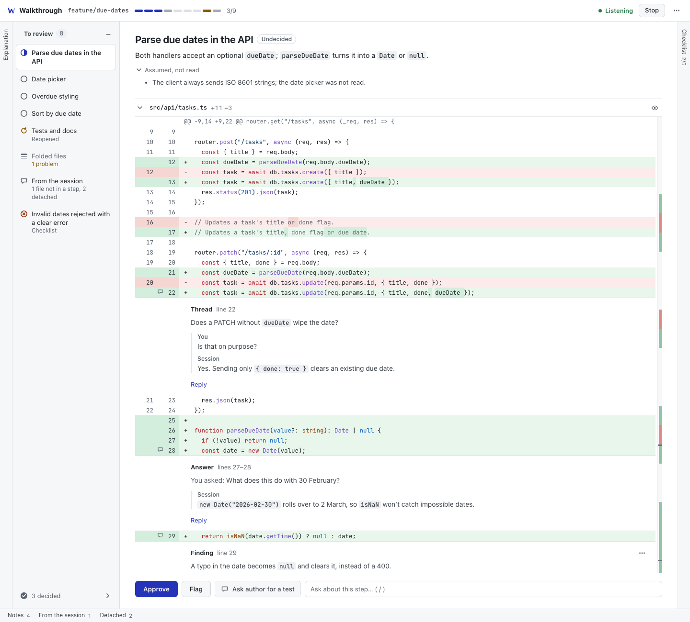
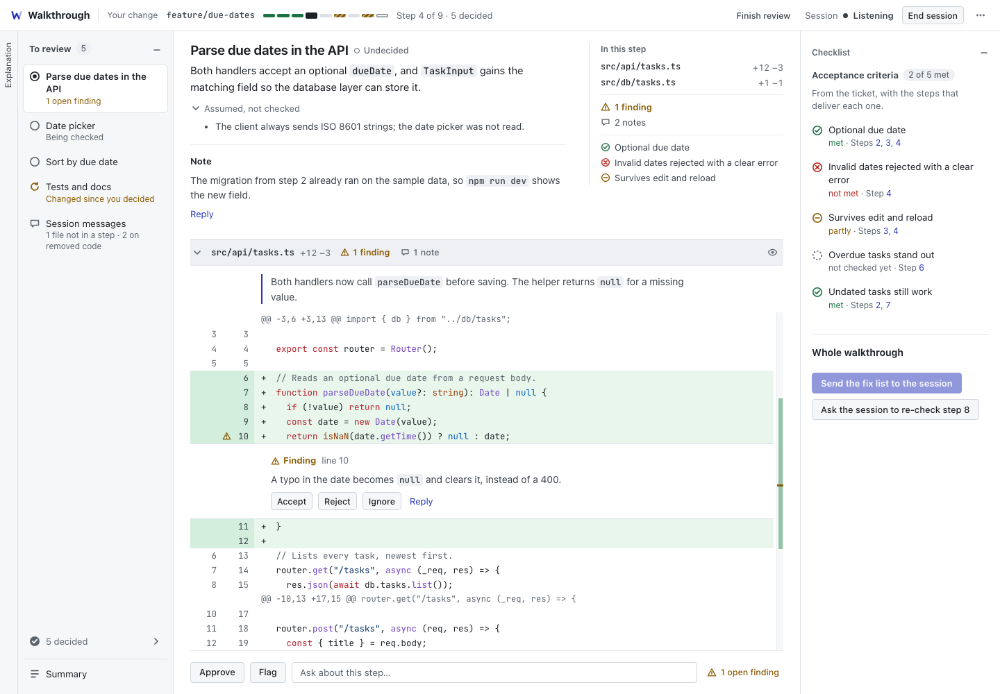
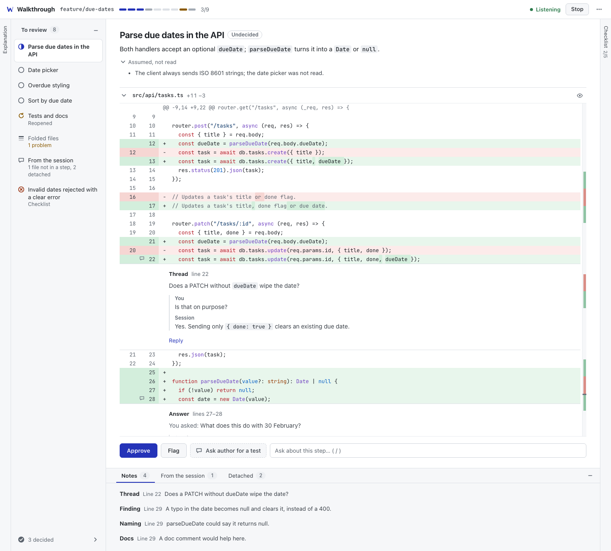
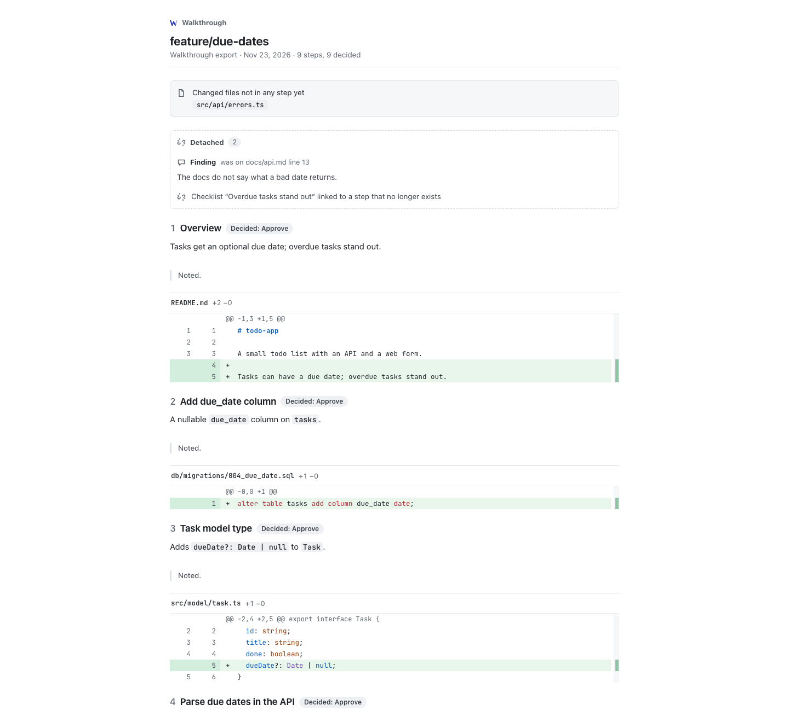

<p align="center"></p>

# Walkthrough

Walkthrough is a Claude Code plugin that walks you through a code change on a local page, one step at a time.
Your own Claude Code session reads the change, splits it into steps, explains each one and answers your questions right on the page.
How it reviews comes from your own rules in `REVIEWER.md` and from the project's instructions for agents.
Nothing about your language, team or code host is hardcoded in the tool.

I built it for two jobs: understanding what an agent wrote before it goes to colleagues, and reviewing a colleague's pull request.
In both cases I want to actually understand the change before I sign off, not scroll through a diff.

<picture>
  <source media="(prefers-color-scheme: dark)" srcset="docs/images/main-dark.png">
  
</picture>

## Install

You need Claude Code, git, and Node.js 22 or later.

```sh
claude plugin marketplace add evan-mcgeek/walkthrough
claude plugin install walkthrough@walkthrough
```

The plugin installs from the `release` branch, which holds the built plugin.

To run it from a clone instead:

```sh
git clone https://github.com/evan-mcgeek/walkthrough.git
cd walkthrough
npm install
npm run build
claude --plugin-dir ./plugin
```

`--plugin-dir` loads the plugin for that session only, so start Claude Code from the repo you want to review and point it at the `plugin` folder of your clone.

## First run

In the repo with the change, run:

```text
/walkthrough
```

With no argument it walks through your current branch against the remote's default branch.
For another target branch, a range of commits or a colleague's pull request, just say so in plain words, and the session passes the right options to the CLI.

The first time, the session finds no review policy and offers one.
Your policy lives at `~/.config/walkthrough/REVIEWER.md` (or under `$XDG_CONFIG_HOME`), outside every project, and starts as a copy of [the template](plugin/skills/walkthrough/REVIEWER.md).

1. Say "later" and the template's defaults apply to this walkthrough.
2. Say "now" and the session goes through the policy section by section, asks how you actually review that part, and edits your copy to match.

While your policy is still the unchanged template, the offer comes back on later runs.

The page opens straight away and shows the session preparing.
Steps appear as soon as the session records them.
Uncommitted edits are left out, with a warning, and nothing is ever checked out.

## How a walkthrough goes

1. **Steps.**
   Each step is a part of the change with its diff and the session's explanation, in reading order.
   What the session assumed rather than read is listed separately.
   Files nobody writes by hand go into a folded step, each with the reason it was folded.
2. **Notes.**
   The session pins findings, answers and drafts to a step or to lines in it.
   Low-priority notes are grouped behind "N more", and you can reply to any note.
3. **Checklist.**
   A list of whatever your policy tracks, each item with a status and links to the steps.
   The template tracks the ticket's acceptance criteria.
4. **Actions.**
   The session offers actions on steps, notes, checklist items and the whole walkthrough.
   Some ask for a note, some let you edit the text first, for example a draft comment for a colleague, which always starts with `[AI]`.
   A step with nothing else recorded offers Approve and Flag.
5. **Ask.**
   Every step has an Ask box.
   To ask about specific lines, click a line number and Shift-click another, and the answer comes back as a note on those lines.
   When the session has a question for you, it shows up on the page as well, often with buttons for the likely answers.
6. **Undo.**
   After a decision, Undo takes it back, and the session gets that too.
   Any decision stays changeable until the end, and an undecided item never reads as approved.
7. **The change moves.**
   When you push fixes, the same walkthrough goes on.
   Steps whose diff didn't change keep your decisions, changed steps reopen, and new files go into new steps.
   Notes whose lines changed stay on the page as detached, never dropped.

Changed Markdown and image files get a Diff / Preview switch, with Before and After for images.
The page follows your system's light or dark theme.

### Layouts

The header switches between four layouts with the same functions: "What's left" (the default, a queue of what still needs you), "Three columns", "Explanation beside code" and "Tool panel".
The page remembers your choice.

| | |
| --- | --- |
|  |  |
|  |  |

It works on a phone as well.
At 390px the actions move to a bottom bar, and "Swipe to decide" in the More menu lets you swipe a step right to approve or left to flag.


### Keyboard

1. `j` and `k`, or the right and left arrows, move between steps; inside a diff or a code block the arrows scroll it instead.
2. To pick lines, press Enter on the first line number and Enter on the last; for one line, press Enter on it twice.
3. Escape cancels a line pick.

### Share it and find it again

Ask the session to export the walkthrough, and it writes one read-only HTML file that opens with no server: steps, diffs, notes with their threads, the checklist and your decisions.
The file carries no page address or token.



Ask which walkthroughs you have open, and it opens a page with this repo's walkthroughs, their progress and last activity.


## Your rules

Everything the session does follows two sources:

1. **Your review policy**, `REVIEWER.md`, outside every project.
   It covers how to split and order steps, how to write explanations, what the checklist tracks, which reviewers run and how their findings are checked, how drafts for colleagues are written, and which actions each kind of walkthrough offers.
   Every rule in it is a default you can edit.
2. **The project's instructions for agents**: its `CLAUDE.md`, `AGENTS.md` and the files they point to.
   Where the two disagree about the project's own code, the project wins; about how you review, your policy wins.

The tool itself has no rules.
Every rule, tracker, code host, reviewer and workflow step belongs to your policy or the project's instructions, and the session carries it out ([ADR 0005](docs/adr/0005-nothing-specific-in-the-tool.md)).

## How it talks to your session

The page reaches the session through `walkthrough listen`, which runs in the background, so the chat stays free; the session answers with `walkthrough say` ([ADR 0004](docs/adr/0004-no-mcp.md)).
The session writes what it records to files in the walkthrough's inbox and passes them to the CLI.

The plugin's hook approves only two things, for the whole session: a `walkthrough` command that runs nothing but itself, and the session's writes to that inbox ([ADR 0006](docs/adr/0006-a-plugin-hook-approves-the-cli.md)).
Anything else, anything the shell would expand or run, and `export --out` still go through your usual permissions.

## Commands

The session runs the `walkthrough` CLI for you, so you rarely type it yourself.
`walkthrough guide` prints the exact recording formats.

| Command | What it does |
| --- | --- |
| `start` | Starts or resumes a walkthrough of the current branch, or of `--base <rev> --head <rev> --label <text>`, and opens its page. |
| `files` | Lists the changed files. |
| `steps`, `note`, `checklist`, `actions` | Record what the session wrote, from a file in the walkthrough's inbox (`--file`) or standard input. |
| `listen` | Waits in the background for what you do on the page. |
| `say` | Puts the session's answer, question or note on the page. |
| `policy` | Says whether your review policy is missing, the unchanged template or your own; `show`, `init` and `save --file` print, create and replace it. |
| `decisions` | Prints your latest decision on every item. |
| `export` | Writes the walkthrough to one read-only HTML file. |
| `list` | Opens a page of this repo's walkthroughs. |
| `stop` | Ends the page and the listener; `stop --list` ends the list page. |
| `prune` | Removes walkthroughs whose branch is gone or whose head is merged, at most once a day on `start`, or one walkthrough by name or id. |

## Token cost

Measured once, on 2026-11-23, with Claude Code 2.1.330 and Claude Opus 5.5, headless, on a range of this repo with 16 changed files (+496/-19).
The session read the review policy template, the project's instructions and the whole diff, recorded six steps, a four-item checklist, three notes and the actions, and stopped the page, with no permission prompt.
It took 29 turns, about 908,000 input tokens (856,000 of them cache reads) and 10,400 output tokens, so about $0.79 at list price.

That covers preparing and recording only, since nobody acted on the page and no reviewer agents ran.
Each reviewer agent your policy runs adds its own cost; one fresh-context reviewer of a 10-file change used about 74,000 tokens in my test runs.
As well, every action you take on the page adds a short turn.

## Design

The page's design system and product notes are in [`docs/design/`](docs/design/), with the logo and icons in [`docs/design/brand/`](docs/design/brand/).
The decisions behind the tool are in [`docs/adr/`](docs/adr/), and the domain language in [`GLOSSARY.md`](GLOSSARY.md).

## Development

```sh
npm install
npx playwright install chromium firefox webkit
npm test                # CLI tests (vitest) and page tests (Playwright) in Chromium
npm run test:browsers   # the same in Chromium, Firefox and WebKit, before a release
npm run lint            # type check and ESLint
```

Tests run with 4 workers by default, so they don't take over a laptop.
Rules for working on the code are in [`AGENTS.md`](AGENTS.md).

### Release

`plugin/dist` is not committed on the development branch, so a marketplace install takes the plugin from the `release` branch.
`npm run release` builds the current commit and commits the result to the local `release` branch: the plugin folder with its built files, the marketplace manifest, `LICENSE` and this README.
It needs a clean working tree, never touches the development history and doesn't push.

To publish, push both branches:

```sh
git push origin main release
```

## License

[MIT](LICENSE)
