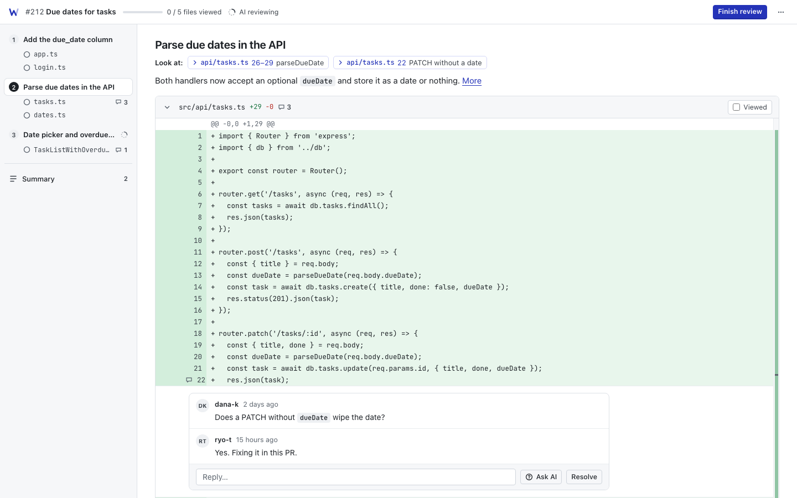
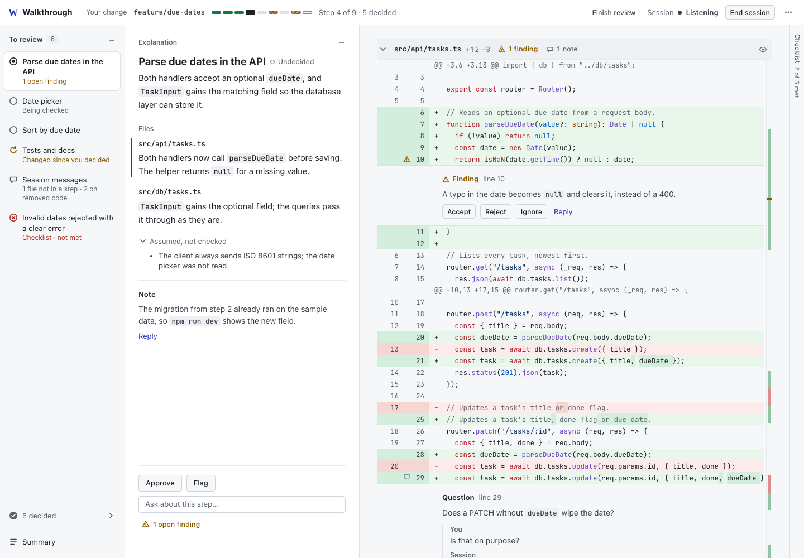

<p align="center"></p>

# Walkthrough

Walkthrough is a Claude Code plugin that walks you through a code change on a local page, one step at a time.
Your own Claude Code session reads the change, splits it into steps, explains each one and answers your questions right on the page.
How it reviews comes from your own rules in `REVIEW.md` and from the project's instructions for agents.
Nothing about your language, team or code host is hardcoded in the tool.

I built it for two jobs: understanding what an agent wrote before it goes to colleagues, and reviewing a colleague's pull request.
In both cases I want to actually understand the change before I sign off, not scroll through a diff.

<picture>
  <source media="(prefers-color-scheme: dark)" srcset="docs/images/main-dark.png">
  
</picture>

## Install

You need Claude Code, git, and Node.js 22 or later.

```sh
claude plugin marketplace add evan-mcgeek/walkthrough
claude plugin install walkthrough@walkthrough
```

The plugin installs from the `release` branch, which holds the built plugin.

To run it from a clone instead:

```sh
git clone https://github.com/evan-mcgeek/walkthrough.git
cd walkthrough
npm install
npm run build
cd /path/to/the/repo/to/review
claude --plugin-dir /path/to/walkthrough/plugin
```

`--plugin-dir` loads the plugin for that session only, so start Claude Code from the repo you want to review and point it at the `plugin` folder of your clone.

## First run

In the repo with the change, run:

```text
/walkthrough
```

With no argument it walks through your current branch against the remote's default branch.
For another target branch or a range of commits, just say so in plain words, and the session passes the right options to the CLI.

To review a change someone asked you to review, run `/walkthrough:pr` with its number or link:

```text
/walkthrough:pr 123
```

The session fetches the change as your policy says, without checking it out.
Your comments become drafts marked `[AI]` that you post, edit or drop on the page, and what you post goes into one pending review that you submit yourself.
Open the same change again after its author replied or pushed, and the walkthrough goes on where you left it.

These are the two kinds of walkthrough, your own change and a review request.
The page header and the list of walkthroughs show which kind each one is.

The first time, the session finds no review policy and offers one.
Your policy lives at `~/.config/walkthrough/REVIEW.md` (or under `$XDG_CONFIG_HOME`), outside every project, and starts as a copy of [the template](plugin/skills/walkthrough/REVIEW.md).

1. Say "later" and the template's defaults apply to this walkthrough.
2. Say "now" and the session goes through the policy section by section, asks how you actually review that part, and edits your copy to match.

While your policy is still the unchanged template, the offer comes back on later runs.

The page opens straight away and shows the session preparing.
Steps appear as soon as the session records them.
Uncommitted edits are left out, with a warning, and nothing is ever checked out.

## How a walkthrough goes

1. **Steps.**
   Each step is a part of the change with its diff and the session's explanation, in reading order.
   What the session assumed rather than read is listed separately.
   Beside the explanation, "In this step" lists the step's files, counts its findings, notes and your comments, and shows the checklist items it touches.
   Files nobody writes by hand go into a folded step of files to skim, each with the reason it was folded.
   Each file collapses from its header; large files start collapsed, and marking a file Viewed collapses it too, which is never a decision.
2. **Notes.**
   The session pins findings, answers and drafts to a step or to lines in it.
   Low-priority notes are grouped behind "N more", and you can reply to any note.
   Lines with notes are marked in the gutter and on a slim overview stripe beside each file, findings in amber.
   While a step has open findings, Approve steps down and the step says how many are open.
3. **Checklist.**
   A list of whatever your policy tracks, each item with a status and links to the steps.
   The template tracks the ticket's acceptance criteria.
4. **Actions.**
   The session offers actions on steps, notes, checklist items, your verdict and the whole walkthrough.
   Some ask for a note, some let you edit the text first, for example a draft comment for a colleague, which always starts with `[AI]`.
   A step with nothing else recorded offers Approve and Flag.
5. **Ask.**
   Every step has an Ask box.
   To ask about specific lines, click a line number and Shift-click another, choose Ask about lines, and the answer comes back as a note on those lines.
   When the session has a question for you, it shows up on the page as well, often with buttons for the likely answers.
6. **Your own comments.**
   Choose Comment on picked lines, or the "+" beside a line number, to write a comment of your own.
   It is yours, never marked `[AI]`, and stays editable and deletable until the session marks it posted.
   On your own change it joins the fix list; on a review request it goes out with your review.
7. **Undo.**
   After a decision, Undo takes it back, and the session gets that too.
   Any decision stays changeable until the end, and an undecided item never reads as approved.
8. **Summary and verdict.**
   The last entry of the queue, or Finish review in the header (G S), is the Summary: every step with what you decided, what is still open first (undecided, being checked or changed since you decided), your flag notes and comments under their steps, the comments the session drafted (`[AI]` drafts) you accepted, edited or dropped, and beside it the verdict, the finishing actions and the checklist.
   You choose your verdict there, from the choices your policy offers, such as Approve, Request changes or Comment on a review request.
   Until then the walkthrough reads "No verdict yet", and the finishing action, such as sending the fix list to the session or sending your review, waits for it.
   Once chosen, the verdict shows quietly in the header, on the list of walkthroughs and in the export.
9. **The change moves.**
   When you push fixes, the same walkthrough goes on.
   Steps whose diff didn't change keep your decisions, changed steps reopen, and new files go into new steps.
   Notes whose lines changed stay on the Session messages page as notes on removed code, never dropped.

Changed Markdown and image files get a Diff / Preview switch, with Before and After for images.

### Panels

Around the step sit three panels, shown or hidden on their own: "To review" (the queue of what still needs you), the checklist with the whole walkthrough's actions, and the explanation column (the step's explanation beside its code).
Each panel hides from the button in its title bar and waits as a labelled button on its edge, so nothing is ever out of reach; the keys `1` to `3` show and hide them too.
Notes stay on their lines; what the session said outside the steps, and notes whose code was removed, wait on the Session messages page in the queue.
By default only the queue is open.
Your choice of panels, accent (Ultramarine, Petrol or Berry) and theme (System, Light or Dark) is kept for you on this machine, for every walkthrough, the list and an export; Appearance is in the header's More menu.

| | |
| --- | --- |
|  |  |
|  | |

It works on a phone as well.
At 390px the actions move to a bottom bar, the panels stack under the step and their switches move into the More menu, and "Swipe to decide" there lets you swipe a step right to approve or left to flag.


### Keyboard

Press `?` for Help: what every icon, colour and status means, then the keyboard shortcuts; every tooltip names its key too.
Keys do nothing while you type, inside a menu or while a popover is open.

| Key | Does |
| --- | --- |
| `j` / `k` | Next / previous step; the right and left arrows too, except inside a diff or a code block, which they scroll |
| `a` | Approve and go to the next step |
| `f` | Flag (asks for a note) |
| `/` | Ask about this step |
| `c` | Comment on the picked lines, or on the line whose number has the focus |
| `v` | Mark the file the focus is in as viewed, or else the step's first file not viewed yet |
| `1` to `3` | Show or hide the queue, the checklist or the explanation column |
| `g` then `s` | Go to the end of the walkthrough |
| `?` | Help: what things mean, and these keys |

To pick lines, click a line number and Shift-click another, or press Enter on the first line number and Enter on the last; for one line, press Enter on it twice.
The picked lines then offer Ask about lines and Comment.
Escape cancels a line pick.

### Share it and find it again

Ask the session to export the walkthrough, and it writes one read-only HTML file that opens with no server: steps, diffs, notes with their threads, the checklist and your decisions.
The file carries no page address or token.


Ask which walkthroughs you have open, and it opens a page with this repo's walkthroughs, their kind, progress, verdict and last activity.


## Your rules

Everything the session does follows two sources:

1. **Your review policy**, `REVIEW.md`, outside every project.
   It covers how to split and order steps, how to write explanations, what the checklist tracks, which reviewers run and how their findings are checked, how drafts for colleagues are written, and which actions each kind of walkthrough offers.
   It has shared rules and a part for each kind of walkthrough, "My change" and "Someone else's change"; each command follows the shared rules and its own part.
   Every rule in it is a default you can edit.
2. **The project's instructions for agents**: its `CLAUDE.md`, `AGENTS.md` and the files they point to.
   Where the two disagree about the project's own code, the project wins; about how you review, your policy wins.

The tool itself has no rules.
Every rule, tracker, code host, reviewer and workflow step belongs to your policy or the project's instructions, and the session carries it out ([ADR 0005](docs/adr/0005-nothing-specific-in-the-tool.md)).

## How it talks to your session

The page reaches the session through `walkthrough listen`, which runs in the background, so the chat stays free; the session answers with `walkthrough say` ([ADR 0004](docs/adr/0004-no-mcp.md)).
The session writes what it records to files in the walkthrough's inbox and passes them to the CLI.

The plugin's hook approves only two things, for the whole session: a `walkthrough` command that runs nothing but itself, and the session's writes to that inbox ([ADR 0006](docs/adr/0006-a-plugin-hook-approves-the-cli.md)).
Anything else, anything the shell would expand or run, and `export --out` still go through your usual permissions.

## Commands

The session runs the `walkthrough` CLI for you, so you rarely type it yourself.
`walkthrough guide` prints the exact recording formats.

| Command | What it does |
| --- | --- |
| `start` | Starts or resumes a walkthrough of the current branch, or of `--base <rev> --head <rev> --label <text>`, and opens its page; `--kind <label>` names its kind for the page, and `--comments <text>` says what becomes of your comments. |
| `files` | Lists the changed files. |
| `steps`, `note`, `checklist`, `actions` | Record what the session wrote, from a file in the walkthrough's inbox (`--file`) or standard input. |
| `checking` | Records the steps the session is still checking; the page holds their decisions until it is done. |
| `listen` | Waits in the background for what you do on the page. |
| `say` | Puts the session's answer, question or note on the page. |
| `policy` | Says whether your review policy is missing, the unchanged template or your own; `show`, `init` and `save --file` print, create and replace it. |
| `decisions` | Prints your latest decision on every item. |
| `comments` | Prints your own line comments as they are now. |
| `posted` | Marks your comments posted once they have gone out, so the page no longer lets you edit them. |
| `export` | Writes the walkthrough to one read-only HTML file. |
| `list` | Opens a page of this repo's walkthroughs. |
| `stop` | Ends the page and the listener; `stop --list` ends the list page. |
| `prune` | Removes walkthroughs whose branch is gone or whose head is merged, at most once a day on `start`, or one walkthrough by name or id. |

## Token cost

Measured once, on 2026-11-23, with Claude Code 2.1.330 and Claude Opus 5.5, headless, on a range of this repo with 16 changed files (+496/-19).
The session read the review policy template, the project's instructions and the whole diff, recorded six steps, a four-item checklist, three notes and the actions, and stopped the page, with no permission prompt.
It took 29 turns, about 908,000 input tokens (856,000 of them cache reads) and 10,400 output tokens, so about $0.79 at list price.

That covers preparing and recording only, since nobody acted on the page and no reviewer agents ran.
Each reviewer agent your policy runs adds its own cost; one fresh-context reviewer of a 10-file change used about 74,000 tokens in my test runs.
As well, every action you take on the page adds a short turn.

## Design

The page's design system and product notes are in [`docs/design/`](docs/design/), with the logo and icons in [`docs/design/brand/`](docs/design/brand/).
The decisions behind the tool are in [`docs/adr/`](docs/adr/), and the domain language in [`GLOSSARY.md`](GLOSSARY.md).

## Development

```sh
npm install
npx playwright install chromium firefox webkit
npm test                # CLI tests (vitest) and page tests (Playwright) in Chromium
npm run test:browsers   # the same in Chromium, Firefox and WebKit, before a release
npm run lint            # type check and ESLint
```

Tests run with 4 workers by default, so they don't take over a laptop.
Rules for working on the code are in [`AGENTS.md`](AGENTS.md).

### Release

`plugin/dist` is not committed on the development branch, so a marketplace install takes the plugin from the `release` branch.
`npm run release` builds the current commit and commits the result to the local `release` branch: the plugin folder with its built files, the marketplace manifest, `LICENSE` and this README.
It needs a clean working tree, never touches the development history and doesn't push.

Every pull request to `main` runs `claude plugin validate --strict` on the plugin and the marketplace manifest.
A pull request labelled `release` publishes when it merges: CI runs the lint and the tests in all three browsers, validates the plugin, runs `npm run release` and pushes the `release` branch.

## License

[MIT](LICENSE)
